# MedMamba-SS-TRM: A Tiny Recursive Classifier for Hyperspectral Breast Histology That Works with Any Number of Bands

**Gabriel M. Del Valle Lopez**
Department of Computer Science

---

***Abstract*—A hyperspectral camera records, for every pixel, how much light the tissue reflects in many narrow wavelength bands, and these spectra can separate tissue types that look alike to the eye. Two practical problems make such data hard to use: cameras differ in how many bands they record, while most neural networks are built for one fixed number, and medical datasets are small, which favours small models. We address both by extending two published architectures, and the model's name records each step. MedMamba-SS adds a spectral–spatial (SS) front end to MedMamba, a state-space classifier for medical images: it reads each pixel's bands as an ordered sequence labelled by wavelength and then averages over them, so no weight depends on the number of bands. MedMamba-SS-TRM then replaces MedMamba's stack of stages with one small network applied 63 times, following the Tiny Recursive Model (TRM). On hyperspectral images of healthy breast tissue, ductal carcinoma *in situ* and invasive ductal carcinoma from 45 patients, MedMamba-SS-TRM has the same 446,409 parameters at 32, 16 and 8 bands. Over five training seeds it reaches 92.8 ± 1.9 % balanced accuracy on the five test patients but 76.2 ± 4.6 % on the five validation patients, and most errors come from three patients. Retrained on 8 bands, it keeps 96 % of its balanced accuracy, and a trained checkpoint transfers to 16 bands without retraining (90.9 %). Reusing one network makes the model 6.2× smaller than its hierarchical predecessor but costs 22.3× more arithmetic, and more than 21 applications add nothing measurable. Because the 32 input bands were selected with labels that included held-out patients, these results are provisional.**

***Index Terms*—Hyperspectral imaging, breast histopathology, state-space models, MedMamba, recursive networks, weight sharing, band-count agnosticism.**

---

## I. Introduction

When a pathologist examines a stained breast biopsy, one of the first questions is whether the tissue is healthy, ductal carcinoma *in situ* (DCIS), a cancer still confined to the milk ducts, or invasive ductal carcinoma (IDC), which has grown into the surrounding tissue. The answer is read from the shape and arrangement of cells. Hyperspectral imaging (HSI) adds a second kind of evidence. A hyperspectral camera measures, at every pixel, how much light the tissue reflects in each of tens to hundreds of narrow wavelength bands, so each pixel carries a spectrum rather than a single colour. Because stained tissue absorbs light according to its chemical make-up, these spectra can separate tissue types that look alike to the eye [1].

Turning such images into a reliable classifier runs into two practical problems. The first is the sensor. Hyperspectral cameras differ in how many bands they record and at which wavelengths, yet the first layer of most image classifiers holds a separate set of weights for every input channel. A model trained for one camera therefore cannot even accept data from another, and it treats the bands as an unordered set, although their order by wavelength is physically meaningful. Histology models are known to degrade even when only the magnification changes [2]; a change of camera, and with it of the band set, is a larger shift. The second problem is data. Hyperspectral medical datasets come from few patients and detailed annotations are scarce [1], [3], and a recent review of deep learning in dermatopathology lists scarce annotations, computational cost and poor generalization across acquisition conditions among the field's main open problems [4]. Small datasets favour small models.

We address both problems by building on two published architectures rather than designing a new one. The first is MedMamba [5], an image classifier for medical data built from state-space models. A state-space model, of which Mamba [6] is the best-known recent example, reads a sequence one element at a time while carrying a compact memory, and learns at each step what to keep and what to forget; its cost grows only linearly with the length of the sequence. MedMamba combines such scans with convolutions and has been evaluated across many medical imaging modalities, which makes it a natural starting point. As published, however, its first layer is tied to the number of input channels and blind to their wavelengths. The second is the Tiny Recursive Model (TRM) [7], which showed that one small two-layer network, applied over and over to refine its own answer, can solve reasoning puzzles better than networks with several times its parameters. The lesson we take from TRM is that depth can come from repetition instead of from stored weights, which is attractive when data are scarce.

Our model follows both base architectures and changes only what hyperspectral histology requires, in two steps whose names record the lineage. **MedMamba-SS**, where SS stands for *spectral–spatial*, keeps MedMamba's spatial processing and replaces its first layer with a spectral pathway: a small module that reads each pixel's bands as an ordered sequence, labels every band with its wavelength, and then averages over the bands, so that none of its weights depends on how many bands there are. **MedMamba-SS-TRM**, where TRM stands for *Tiny Recursive Model*, keeps that spectral pathway and replaces the stack of processing stages of MedMamba-SS with TRM's single network applied recursively. The result has 446,409 parameters whatever the number of input bands.

Our contributions are:

- MedMamba-SS, a spectral–spatial extension of MedMamba whose parameters do not depend on the number of bands;
- MedMamba-SS-TRM, a recursive version that follows TRM, with 6.2× fewer parameters than MedMamba-SS and an explicit account of the extra arithmetic that recursion costs;
- an evaluation on hyperspectral breast histology from 45 patients, over five seeds and patient by patient, that shows where the model works and where it fails.

The paper follows the model from its origins to its behaviour. Section II summarizes the two base architectures, Section III introduces the data, and Section IV builds MedMamba-SS and MedMamba-SS-TRM step by step. Section V describes how the models were trained and measured, Section VI asks what the trained model can and cannot do, Section VII discusses what we learned and the limits of the evidence, and Section VIII concludes.

---

## II. The Two Models We Build On

Both base models are described in full in their original papers [5], [7] and code [8], [9]; we summarize only what the rest of this paper needs. Fig. 1 shows how the two combine into our models.

<!-- tex: mermaid=fig_lineage; wide; width=0.82 -->
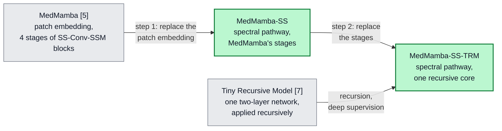

*Fig. 1. Where our models come from. Each arrow from a grey base model is one substitution; green boxes are the models of this paper (Section IV).*

### A. Hyperspectral Patches

We work with small hyperspectral patches $X \in \mathbb{R}^{C \times H \times W}$: images of $H \times W$ pixels with $C$ bands, where band $c$ is centred at wavelength $\lambda_c$. Reading along the band axis at one pixel gives that pixel's spectrum, a vector of $C$ values ordered by wavelength. Neighbouring bands are strongly correlated, and the shape of the spectrum, more than any single value, carries the information.

### B. MedMamba

MedMamba [5] processes an image in three parts. A *patch embedding*, a strided convolution, turns the input into a grid of feature vectors. Four *stages* of SS-Conv-SSM blocks then process the grid. Each block splits its channels in two: one half goes through convolutions that capture local texture, the other through a two-dimensional selective scan (SS2D) [10] that sweeps the grid in four directions and captures long-range context, and the two halves are then mixed again. Between stages, *patch merging* halves the grid and doubles the number of channels, so deeper stages see the image at coarser scales. A classifier reads the last stage.

One component of this design does not fit hyperspectral data. The patch embedding has a separate weight for every input channel: with patch size $p$ and $D_0$ output channels it holds

$$p^2 C D_0 + 3 D_0 \tag{1}$$

parameters, including its normalization, so its size grows with the band count $C$. A model built for 32 bands cannot accept 16, and because the convolution sums over channels as an unordered set, it never uses the fact that bands are ordered by wavelength.

### C. The Tiny Recursive Model

TRM [7] replaces a deep stack of different layers with one small network $f$ of two layers that is used many times. Besides the embedded input $x$, it keeps two states: an *answer* state $y$, its current guess, and a *latent* state $z$, a scratchpad. One *improvement step* first refines the scratchpad $n$ times and then updates the answer:

$$z \leftarrow f(x + y + z) \;\; (n \text{ times}), \qquad y \leftarrow f(y + z). \tag{2}$$

A recursion runs $T$ improvement steps; to save memory, the first $T-1$ run without tracking gradients, so they refine the states but are not trained through. Training uses *deep supervision*: the recursion is repeated over several supervision segments, each segment's answer is scored by the loss, and the states are carried into the next segment. In plain terms, the network drafts an answer and keeps revising it, and every revision is graded. TRM also learns a halting signal that decides when to stop, and it evaluates an exponential moving average (EMA) of its weights, a smoothed copy that changes slowly during training. It was evaluated on small puzzles with exact answers, and it reports parameters and accuracy but not arithmetic cost.

---

## III. Data

All experiments use the HistologyHSI-BC-Recurrence collection [11], [12]: hyperspectral images, taken at 10× magnification, of breast biopsy slides stained with haematoxylin and eosin (H&E). The release we use holds 644 captures from 45 patients. Each capture has 740 bands, most are 600 × 1,004 pixels, and each carries one tissue label: healthy, DCIS or IDC. We start from the collection's calibrated images and multiply each capture by a gain that brings its median intensity to the median over all captures (clipped to [0.5, 2]); all values are then divided by one global constant. Neither step uses labels, but both are computed over captures from all patients.

**Patients and patches.** The 45 patients are split into 35 for training, 5 for validation and 5 for testing, at random within groups defined by each patient's rarest tissue class, so that no patient appears in more than one set. Only seven patients have DCIS: five are in training, one (patient 197) in validation and one (patient 136) in test. Every capture is cut into non-overlapping 11 × 11 patches, and every patch inherits its capture's label; no pixel-level mask is applied, so a patch from a capture labelled IDC may contain stroma or background. Table I gives the counts. Two facts from it shape the rest of the paper: IDC outnumbers DCIS 13 to 1 in training, and each held-out set has DCIS from a single patient.

<!-- tex: wide; cols=lrrrr -->
**TABLE I**
**Patients / Captures / Patches per Class and Split**

| Split | Healthy | DCIS | IDC | All |
| --- | ---: | ---: | ---: | ---: |
| Training | 30 / 147 / 722,358 | 5 / 25 / 122,850 | 34 / 327 / 1,606,878 | 35 / 499 / 2,452,086 |
| Validation | 4 / 20 / 98,280 | 1 / 5 / 24,570 | 5 / 49 / 211,666 | 5 / 74 / 334,516 |
| Test | 4 / 17 / 83,538 | 1 / 5 / 24,570 | 5 / 49 / 240,786 | 5 / 71 / 348,894 |

*A patient is counted under every tissue type it has. A full-size capture gives 4,914 patches.*

**Band selection.** Using all 740 bands would make every patch large and highly redundant, so one preparation step keeps 32. Each band is scored by the average of its variance and its mutual information with the tissue label [13], that is, how much knowing the band's value tells about the label, and bands are taken in order of decreasing score, skipping any band within eight bands of, or correlated above 0.95 with, a band already taken. The 32 bands span 400.5–938.2 nm unevenly: 18 lie at or below 633.3 nm and 14 between 852.3 and 938.2 nm, with a 219 nm gap between them where the scores are lowest. Fig. 2(a) shows the class-mean spectra over these bands, and Fig. 2(b) one patch of each class.

<!-- tex: width=1.0 -->
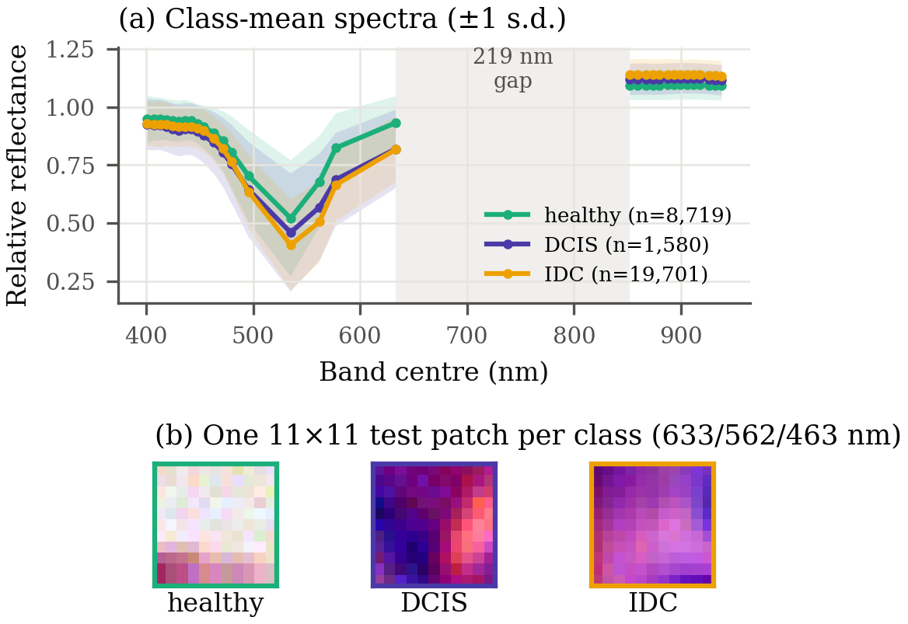

*Fig. 2. (a) Class-mean spectra of 30,000 training patches over the 32 selected bands; no line is drawn across the 219 nm gap. (b) One test patch per class, shown as a false-colour composite of three bands.*

One caveat matters for everything that follows. The band scores were computed on 64 captures drawn before the patient split, 16 of them from validation and test patients, so labels of held-out patients influenced which bands the model sees. Repeating the selection on training patients alone moves every band by at most 5.1 nm (median 1.5 nm) and keeps the same layout, but no model has yet been retrained on that version, so the results below are provisional on this point.

---

## IV. From MedMamba to MedMamba-SS-TRM

We build the model in two steps, and each step replaces exactly one component of the model it starts from (Fig. 1). The first step gives MedMamba a front end that reads spectra and does not depend on the band count (Section IV-A), which yields MedMamba-SS (Section IV-B). The second replaces the stages of MedMamba-SS with TRM's recursion (Section IV-C), which yields MedMamba-SS-TRM; Section IV-D states what that recursion costs.

### A. Step 1: The Spectral Pathway

The spectral pathway replaces MedMamba's patch embedding. Its job is to turn each pixel's spectrum, whatever its length, into a vector of fixed size. The idea is borrowed from language models: we treat a spectrum like a sentence in which each band is a word, and the band's wavelength plays the role of the word's position. Every operation either shares its weights across all bands or has no weights at all, so the same weights serve any number of bands. Fig. 3 shows the four operations and the tensor shapes for one patch.

<!-- tex: mermaid=fig_pathway; wide; width=0.95 -->
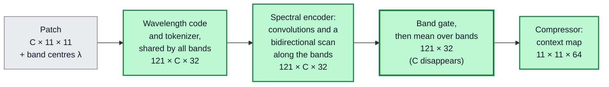

*Fig. 3. The spectral pathway, with tensor shapes for one 11 × 11 patch with $C$ bands (121 pixels, tokens of width 32). Every step applies the same weights to every band; the band axis disappears at the mean over bands, so nothing after it depends on $C$.*

**Wavelength code.** Band centres are rescaled to the unit interval over the bands present, and a sinusoidal code, like the position code of a Transformer [14], is computed from the result:

$$\begin{aligned} \tilde{\lambda}_c &= \frac{\lambda_c - \lambda_{\min}}{\lambda_{\max} - \lambda_{\min}}, \\ \pi_c[2i] &= \sin(\eta\, \tilde{\lambda}_c\, \omega_i), \quad \pi_c[2i+1] = \cos(\eta\, \tilde{\lambda}_c\, \omega_i), \end{aligned} \tag{3}$$

with frequencies $\omega_i = 10000^{-2i/d_t}$ and scale $\eta = C$. Unlike a code based on the band index, this one registers the 219 nm gap of Section III as a large step. Because the rescaling and $\eta$ both depend on the bands present, a given wavelength receives a different code when bands are removed; Section VI-B shows why this matters.

**Tokenizer.** One small two-layer network, shared by all bands, turns each band value $v_c$ and its code into a token of width $d_t = 32$:

$$t_c = W_2\, \mathrm{GELU}\big(W_1 [v_c \,;\, \pi_c] + b_1\big) + b_2 + g\, \pi_c. \tag{4}$$

**Spectral encoder.** The sequence of $C$ tokens passes through small one-dimensional convolutions along the band axis, which compare each band with its neighbours, and through a bidirectional selective scan [6], which reads the whole sequence from short to long wavelengths and back. This scan has the gated form of MedMamba's selective scan, applied to the one axis that MedMamba does not model; scanning spectra in both directions follows [15].

**Band gate and pooling.** A learned gate gives each band a weight between 0 and 1, and the weighted tokens are averaged over the bands and compressed by a small network $\Psi$ into a context vector of size 64 for each pixel:

$$a_c = \sigma\big(w_g^{\top} t_c + b_g\big), \qquad u = \Psi\Big(\frac{1}{C} \sum_{c=1}^{C} a_c\, t_c\Big) \in \mathbb{R}^{64}. \tag{5}$$

The average in (5) is where the band axis disappears. The gate also leaves a readable record of which wavelengths the pathway emphasizes, which Section VI-F examines.

> **Property 1.** *No weight of the spectral pathway has a shape that depends on $C$, and every layer after the average in (5) receives inputs without a band axis. A model built on the pathway therefore has the same number of parameters for every band count, as long as its later layers do not output one value per band.*

The reason is simple: the code (3) and the average in (5) have no weights, and the tokenizer, convolutions, scan and gate apply the same weights to every band. The one module that breaks the property is the optional reconstruction decoder of Section IV-C, which outputs one channel per band; we therefore exclude it from every parameter and cost count. In total the pathway holds 38,724 parameters (Section IV-C gives the full count).

### B. MedMamba-SS

MedMamba-SS places the spectral pathway in front of MedMamba's stages (Fig. 4(a)). A linear layer, the *stem*, projects the context map into the first stage, so the convolutional patch embedding, and with it the dependence on $C$, is gone. To let the spectrum inform every scale and not only the input, each stage is conditioned on the context map through FiLM [16], which scales and shifts a block's features according to the spectrum, and a small gated update feeds the spatial features back into the context map between stages. The blocks keep MedMamba's channel split, convolutional branch and selective scan, and gain LayerScale [17] and a gated feed-forward layer (GEGLU) [18]; the classifier reads every stage. For 11 × 11 patches MedMamba-SS uses three stages of widths 64, 128 and 256 and has 2,773,007 parameters. We also built a *full-channel* variant in which both branches of each block see all channels (3,513,451 parameters).

<!-- tex: mermaid=fig_models; wide; width=0.95 -->
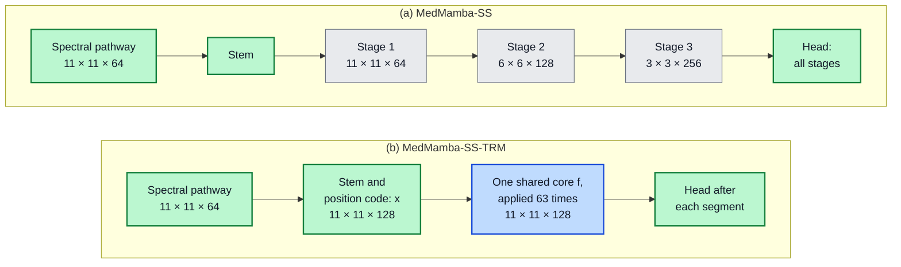

*Fig. 4. The two proposed models on one 11 × 11 patch, with tensor shapes. (a) MedMamba-SS keeps MedMamba's stage structure (grey; its blocks gain spectral conditioning), which shrinks the grid and widens the features. (b) MedMamba-SS-TRM replaces them with one core that follows TRM (blue) and keeps the full grid throughout. Green: components introduced in this work.*

### C. Step 2: Recursion

The second step replaces the stack of stages with TRM's recursion (Fig. 4(b)). We follow TRM's design and change only what a two-dimensional classification task requires; Table II lists where every component comes from and what changed.

**Input and states.** The context map is projected to width $d = 128$, normalized, and given a fixed two-dimensional position code, which gives the input $x$ of shape 11 × 11 × 128. As in TRM, the answer state $y$ and the latent state $z$ have the same shape and start from fixed values.

**Core.** The shared network $f$ has two blocks. Each block mixes neighbouring pixels with a depthwise 3 × 3 convolution, which filters every channel separately, followed by a channel MLP, and then applies a GEGLU feed-forward layer [18]; each part ends with RMS normalization [19], as in TRM. TRM mixes tokens with attention or an MLP; we use a convolution because our state is an 11 × 11 grid rather than a sequence. MedMamba's SS2D scan is implemented as an alternative mixer, but without a fused scan kernel it was 39× slower in a timing benchmark on 11 × 11 patches, so it is not used. MedMamba-SS-TRM therefore keeps a selective state-space scan along the spectral axis, inside its spectral pathway, but processes space with convolutions; its name records the lineage through MedMamba-SS.

**Schedule.** The core is applied exactly as in (2), with $n = 6$ and $T = 3$ (Fig. 5). We run $N_{\text{sup}} = 3$ supervision segments inside a single forward pass and read the answer state after each with a small classifier (normalization, average over pixels, linear layer). The core is therefore applied

$$K = N_{\text{sup}} \cdot T \cdot (n + 1) = 3 \cdot 3 \cdot 7 = 63 \tag{6}$$

times per patch, at inference as well as in training. Keeping all segments in one forward pass, with one optimizer step per batch, lets a standard training loop run unchanged. TRM's halting signal is implemented but disabled, because on our task it did not learn to predict when an answer was correct.

<!-- tex: mermaid=fig_schedule; wide; width=0.62 -->
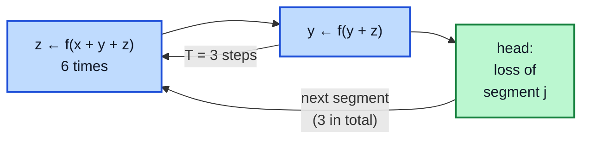

*Fig. 5. The recursion of MedMamba-SS-TRM, following TRM (blue); $x$ comes from the stem and $y$, $z$ start from fixed values. An improvement step is six latent updates and one answer update; the first two of the three steps run without gradient. Three segments give the 63 core applications of (6); each segment's answer is scored by the loss, and the last one is the prediction.*

**Objective.** Each segment's prediction is scored by a class-weighted focal loss [20], which down-weights patches the model already classifies confidently and so counteracts the class imbalance. For a patch of class $k$ with predicted probability $p_k$,

$$\mathcal{L}_{\text{FL}} = -\,w_k\,(1 - p_k)^{\gamma} \log p_k, \qquad \gamma = 1.5, \tag{7}$$

where the class weight $w_k$ is proportional to $N_k^{-0.75}$, $N_k$ being the number of training patches of class $k$. As an auxiliary task, a three-layer convolutional decoder reconstructs the input spectra $X$ from the final answer state, and the total loss is

$$\begin{aligned} \mathcal{L} = \frac{1}{N_{\text{sup}}} \sum_{j=1}^{N_{\text{sup}}} \mathcal{L}_{\text{FL}}(\ell_j) &+ \lambda\, \mathrm{MSE}(\hat{X}, X) \\ &+ \lambda\, \mathrm{SAM}(\hat{X}, X), \end{aligned} \tag{8}$$

where $\ell_j$ are the class scores of segment $j$, $\hat{X}$ is the reconstruction, SAM is the spectral angle (11), and $\lambda = 0.1$. The decoder is not needed at inference. Table III gives the resulting parameter count: the shared core holds 89 % of the parameters, and no entry depends on $C$ or on $K$.

<!-- tex: wide; x=p{3.3cm}p{3.9cm}X p{3.6cm} -->
**TABLE II**
**Where Each Component of MedMamba-SS-TRM Comes From**

| Component | Origin | In MedMamba-SS-TRM | Reason |
| --- | --- | --- | --- |
| Spectral pathway | New; replaces MedMamba's patch embedding [5] | Wavelength code, shared tokenizer, spectral encoder, band gate, mean over bands (3)–(5) | Remove $C$ from every weight shape; read band order |
| Bidirectional spectral scan | MedMamba's selective scan [5], [6] | Applied along the bands, in both directions | Model the ordered spectrum |
| Stages of SS-Conv-SSM blocks | MedMamba [5], kept in MedMamba-SS | Replaced by one recursive core | Depth from reuse instead of stored weights |
| Core network $f$ | TRM [7]: two layers, attention or MLP mixer, width 512 | Two blocks, depthwise-convolution mixer, GEGLU, width 128 | The state is a 2-D grid; smaller model |
| Two states, improvement step, first $T-1$ steps without gradient | TRM [7] | As published (2), $n = 6$, $T = 3$ | — |
| Deep supervision | TRM [7]: up to 16 segments, one optimizer step each | 3 segments in one forward pass, losses averaged (8) | A standard training loop runs unchanged |
| Halting signal | TRM [7] | Implemented, disabled | Did not learn on this task |
| EMA of weights | TRM [7]: decay 0.999 | Decay 0.9995 | Retuned |
| Stem, head and loss | New | Linear stem with position code; classifier after every segment; focal loss and reconstruction (7)–(8) | Classify a 2-D map into three imbalanced classes |

<!-- tex: x=Xrr -->
**TABLE III**
**Parameters of MedMamba-SS-TRM (Decoder Excluded)**

| Component | Parameters | Share |
| --- | ---: | ---: |
| Spectral pathway (3)–(5): tokenizer 4,257; encoder 17,794; gate 33; compressor 16,640 | 38,724 | 8.7 % |
| Stem and position-code gain | 8,577 | 1.9 % |
| Shared core $f$, $L(12d^2 + 20d)$ with $L = 2$ blocks | 398,336 | 89.2 % |
| Classifier and (disabled) halting head | 772 | 0.2 % |
| **Total, at any band count** | **446,409** | |

*No entry depends on the band count $C$ or on the number of core applications $K$.*

### D. What Recursion Costs

Weight sharing separates two quantities that usually grow together: how many parameters a model stores and how much arithmetic, counted in floating-point operations (FLOPs), it performs. The core's parameters do not depend on how often it is applied, but every application costs the same arithmetic:

$$\mathcal{F}(K) = \mathcal{F}_0 + K\, \mathcal{F}_f, \qquad \mathcal{F}_f = 2\, N_{\text{tok}}\, L\, \big(12 d^2 + 9 d\big), \tag{9}$$

where $\mathcal{F}_0$ is everything outside the core, $N_{\text{tok}} = 121$ is the number of grid positions, $L = 2$ is the number of blocks, $12 d^2$ counts the multiply–accumulates per position of a block's two gated MLPs and $9d$ its depthwise convolution. For our configuration $\mathcal{F}_f = 95.72$ MFLOPs, so the 63 applications alone cost 6.03 GFLOPs per patch. A hierarchy is cheaper because it shrinks the grid at every stage (Fig. 4(a)); the recursive core works on the full grid at every application. We measure arithmetic by counting the multiply–accumulates of every convolution and linear layer with forward hooks, plus an estimate for the selective scans; normalization, activations and the decoder are excluded.

---

## V. Experimental Setup

### A. How We Measure Performance

Because IDC patches outnumber DCIS patches 13 to 1, plain accuracy would reward a model that ignores DCIS. Our main metric is therefore *balanced accuracy*, the average over the three classes of the recall, the fraction of a class's patches classified correctly:

$$\mathrm{BA} = \frac{1}{3} \sum_{k} \frac{\mathrm{TP}_k}{\mathrm{TP}_k + \mathrm{FN}_k}. \tag{10}$$

A model that always predicts IDC scores 33.3 %. We also report *macro-F1*, the average over classes of the harmonic mean of precision and recall. Reconstruction is scored by the *spectral angle* between a reconstructed spectrum $\hat{x}$ and its target $x$,

$$\mathrm{SAM}(\hat{x}, x) = \arccos \frac{\langle \hat{x}, x \rangle}{\lVert \hat{x} \rVert\, \lVert x \rVert}, \tag{11}$$

which ignores overall brightness and compares only the shape of the spectrum. *Calibration*, whether a predicted confidence of 90 % is right 90 % of the time, is measured by the expected calibration error (ECE) over 15 confidence bins [21], [22] and by the Brier score [23].

### B. Training

All models were trained on one NVIDIA RTX 5060 Ti (16 GB) with PyTorch [24]. MedMamba-SS-TRM uses AdamW [25] with learning rate $3 \times 10^{-4}$ and weight decay 0.05, batch size 256, bf16 precision, gradient clipping at 1.0, and a linear warm-up into a cosine decay; gradient checkpointing [26] in the core is needed to fit training into 16 GB, and validation and testing use an EMA of the weights. Inputs are standardized per band with statistics from the training patients and augmented with flips, rotations, crops and small spectral noise, scaling and offsets. Each epoch trains on a fresh random 10.2 % of the training patches (250,113) and validates on a fixed patient-stratified 9.86 % of the validation patches (32,985); the checkpoint with the best validation macro-F1 is then scored on the full test set.

Main runs train for 20 epochs and are repeated with five seeds (1, 7, 13, 23 and 42). The component studies of Sections VI-B to VI-D train for 12 epochs at seed 42 and are compared with a 12-epoch run of the full model, because a shorter cosine schedule is a different schedule, not a truncated one. Two runs with the same seed differ by about 0.05 points of balanced accuracy, whereas the spread between seeds is about 2 points, so single-seed differences smaller than that spread are not conclusive. The training recipe was developed over earlier runs on the same patient split. Checkpoints were always chosen on validation data, but the test scores of those development runs were recorded, so the test patients are not demonstrably independent of recipe development.

---

## VI. Results

We now follow the trained model through six questions, from whether it learns at all to what it attends to. Unless stated otherwise, results are on the five test patients; we also report the five validation patients, scored on their full split, and all ten held-out patients pooled.

### A. Does the Model Learn?

Table IV lists every seed. On the five test patients MedMamba-SS-TRM reaches 92.8 ± 1.9 % balanced accuracy, on the five validation patients 76.2 ± 4.6 %, and pooled over all ten 84.5 ± 1.4 %. Two patterns stand out. First, the gap between the two patient sets averages 16.6 points (6.6 to 22.3, depending on the seed), several times the standard deviation between seeds on either set. Second, the seeds trade one set against the other: the seed that is best on the test patients (42) is the worst on the validation patients, and across the five seeds the two scores are strongly anti-correlated (Pearson $r = -0.95$, descriptive only with five points). Section VI-E traces the gap to a few patients. Validation scores are also slightly optimistic, because the validation patients choose each run's checkpoint.

<!-- tex: wide; cols=lrrrrrr -->
**TABLE IV**
**MedMamba-SS-TRM at Five Seeds: Test (5 Patients), Validation (5 Patients) and Pooled (10 Patients)**

| Seed | Test BA (%) | Test macro-F1 | Val. BA (%) | Val. macro-F1 | Pooled BA (%) | Pooled macro-F1 |
| --- | ---: | ---: | ---: | ---: | ---: | ---: |
| 1 | 89.61 | 0.808 | 83.00 | 0.749 | 86.32 | 0.777 |
| 7 | 93.41 | 0.896 | 74.37 | 0.722 | 83.94 | 0.808 |
| 13 | 92.76 | 0.869 | 78.66 | 0.735 | 85.74 | 0.799 |
| 23 | 93.78 | 0.898 | 72.77 | 0.700 | 83.26 | 0.796 |
| 42 | 94.37 | 0.904 | 72.11 | 0.694 | 83.21 | 0.795 |
| **Mean ± s.d.** | **92.78 ± 1.87** | **0.875 ± 0.040** | **76.18 ± 4.59** | **0.720 ± 0.023** | **84.49 ± 1.45** | **0.795 ± 0.011** |

*BA: balanced accuracy (10). Test: 348,894 patches; validation: 334,516; pooled: both. Chance level is 33.33 %.*

Fig. 6 shows how the seed-42 run trains. Training loss keeps falling, but validation loss is lowest at epoch 9 and rises afterwards, and validation macro-F1 peaks at epoch 7: the model keeps fitting the 35 training patients after it stops improving on the 5 validation patients, and checkpoint selection keeps the epoch before that divergence. So the model does learn, but how well it does depends on which patients it is tested on.

<!-- tex: width=1.0 -->
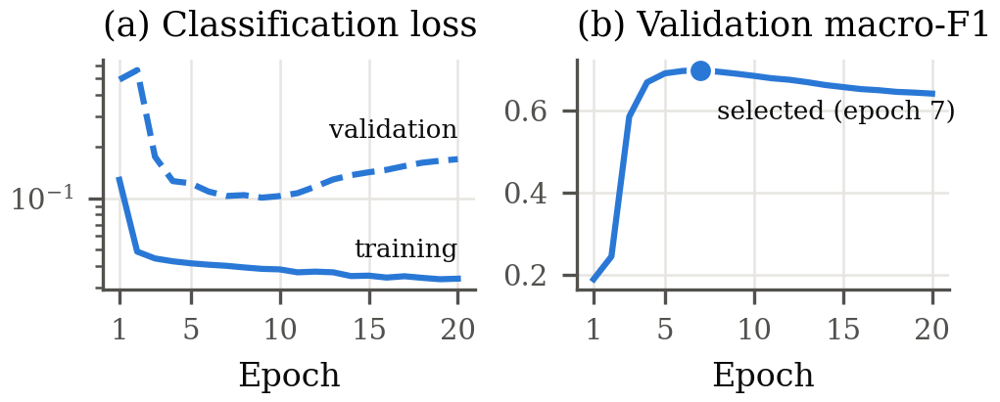

*Fig. 6. Training of the seed-42 model. (a) Classification loss on the training and validation subsets (log scale). (b) Validation macro-F1; the dot marks the selected checkpoint.*

### B. Does It Really Ignore the Number of Bands?

Property 1 predicts that the parameter count does not change with the band count, and it does not: trained at 32, 16 and 8 bands, the model has 446,409 parameters each time. What changes is the size of the intermediate activations; peak inference memory, with the decoder attached, is 161, 100 and 69 MB.

The harder question is whether a trained model still works on a different set of bands. Fig. 7 answers it in two ways on the test patients. *Retraining* at a lower band count works: with 8 of the 32 bands, chosen evenly by index, the model keeps 96 % of its 12-epoch balanced accuracy (0.901 against 0.935). Applying a 32-band checkpoint to fewer bands *without* retraining (zero-shot) fails with the wavelength code as defined in (3): at every reduced band count balanced accuracy falls to 0.33–0.41, near chance. The cause is the scale $\eta = C$. The subsets keep both end bands, so the rescaling in (3) is unchanged, but $\eta$ changes with $C$, so every remaining band receives a code the model never saw in training. Holding $\eta$ at its training value of 32, and changing nothing else, restores most of the accuracy at 16 bands (0.909 instead of 0.385), though not at 8 (0.560). These are post-hoc evaluations of a single checkpoint. The architecture is therefore band-count agnostic by construction and under retraining, and a trained model transfers to half of its bands once the scale of its code is fixed, but not to a quarter of them.

<!-- tex: width=1.0 -->
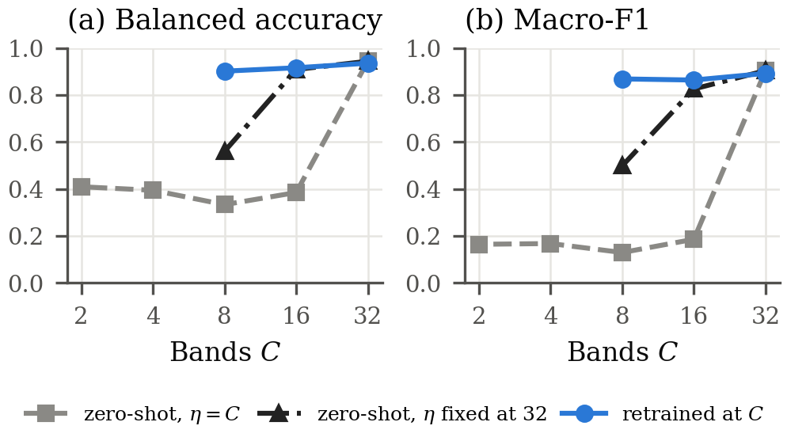

*Fig. 7. Test performance against the number of bands $C$ (subsets chosen evenly by band index, both end bands kept). Zero-shot, $\eta = C$: the 32-band checkpoint with the code as defined in (3). Zero-shot, $\eta$ fixed at 32: the same checkpoint with the code's scale held at its training value. Retrained: a model trained at that band count (12 epochs; the 32-band point is the 12-epoch reference run).*

### C. What Does Recursion Buy, and What Does It Cost?

Fig. 8(a) varies only the number of improvement steps $T$, from 1 to 4, which sets the number of core applications to 21, 42, 63 or 84. Quality is flat: balanced accuracy stays between 0.935 and 0.944, and the reported configuration of 63 applications is no better than 21. With $T = 1$ there is no gradient-free step at all, so on this task neither depth beyond 21 applications nor the gradient-free refinement buys anything measurable.

The cost behaves as (9) predicts (both count the same operations, so this is a consistency check rather than an independent test). Fig. 8(b) shows the measured arithmetic on a straight line of 95.72 MFLOPs per core application, from 2.18 GFLOPs at 21 applications to 8.21 GFLOPs at 84. Fig. 8(c) sets this against the hierarchy: MedMamba-SS-TRM stores 6.2× fewer parameters than MedMamba-SS (446,409 against 2,773,007) but needs 22.3× more arithmetic per patch (6.20 against 0.28 GFLOPs), at inference as well as in training. A weight-shared recursive model is small to store, not cheap to run.

<!-- tex: wide; width=1.0 -->
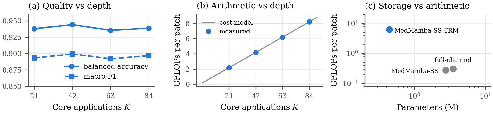

*Fig. 8. (a) Test quality against the number of core applications $K$ (12 epochs, seed 42). (b) Measured arithmetic per patch, decoder excluded, against the cost model (9). (c) Parameters against arithmetic for MedMamba-SS-TRM and the two hierarchical MedMamba-SS variants (log scales).*

### D. Which Parts Matter?

Table V removes or changes one component at a time (12 epochs, seed 42). Removing the reconstruction objective lowers balanced accuracy by 1.3 points, mostly through DCIS, and replacing the wavelength code with a plain band-index code lowers it by 0.6 points, with two independent runs agreeing closely. Both effects are smaller than the 1.9-point spread between seeds, so they suggest, but do not establish, that each component helps. If the wavelength code does help, a likely reason is the 219 nm gap, which an index code treats as an ordinary step between neighbours.

<!-- tex: wide; x=Xrrrr -->
**TABLE V**
**Component Study (Test Patients, 12 Epochs, Seed 42)**

| Variant | BA | Macro-F1 | DCIS F1 | Δ BA (points) |
| --- | ---: | ---: | ---: | ---: |
| MedMamba-SS-TRM, full | **0.9353** | **0.8920** | **0.769** | — |
| − reconstruction objective | 0.9225 | 0.8708 | 0.733 | −1.28 |
| Band-index code instead of wavelength code (two runs) | 0.9291 / 0.9287 | 0.8804 / 0.8798 | 0.748 / 0.747 | −0.62 / −0.66 |
| 16 bands, retrained | 0.9159 | 0.8636 | 0.717 | −1.95 |
| 8 bands, retrained | 0.9014 | 0.8684 | 0.715 | −3.39 |
| 21 core applications instead of 63 | 0.9378 | 0.8932 | 0.774 | +0.25 |
| Hierarchical backbone (MedMamba-SS) | 0.3342 | 0.2741 | 0.001 | −60.12 |
| Hierarchical backbone, full-channel variant | 0.4085 | 0.3974 | 0.228 | −52.68 |

*The seed-to-seed standard deviation of test BA at 20 epochs is 1.87 points (Table IV).*

The last two rows put the hierarchical MedMamba-SS back in place of the recursive core, and both hierarchical variants stay near chance. For the standard variant, training accuracy rises from 0.74 to 0.91 while the validation output stays constant, a typical sign of a layer that behaves differently in training and in evaluation. The convolutional branch inherited from MedMamba uses batch normalization, and its stored statistics turned out to be far from those of test batches (channel means up to 3.8 standard deviations apart). Normalizing with the statistics of each test batch instead stops the standard variant from predicting IDC everywhere, but it still reaches only 0.49 balanced accuracy on a class-balanced sample of 9,000 test patches. Lower learning rates, removing the decoder and looser gradient clipping did not help either. Under a recipe developed for the recursive model, therefore, only the recursive model trained on 11 × 11 hyperspectral patches; why the hierarchy learns so little here is an open question.

### E. Where Does It Fail?

Fig. 9(a) shows the test confusion matrix at seed 42. IDC is recognized almost perfectly, and at every seed the test precision for IDC rounds to 1.000, so the errors are almost all healthy patches predicted as DCIS (14.3 % of healthy test patches at seed 42).

<!-- tex: width=1.0 -->
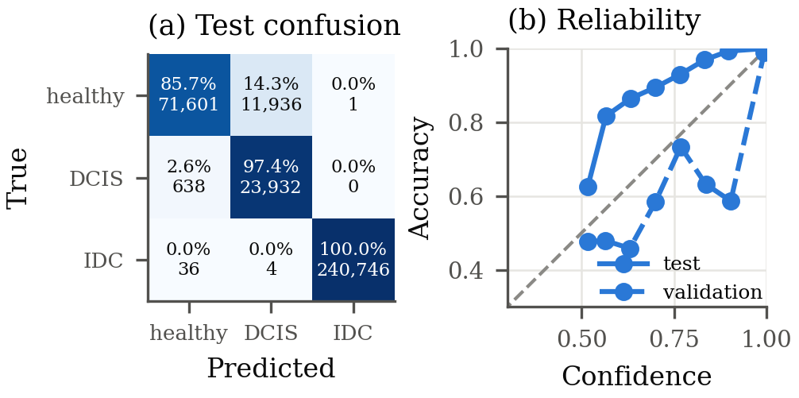

*Fig. 9. Errors and confidence of the seed-42 model. (a) Test confusion matrix, row-normalized, with patch counts. (b) Reliability on the test and validation patients over 15 confidence bins; bins with at most 200 patches are not drawn, and the dashed diagonal is perfect calibration.*

Table VI shows that these errors are concentrated in individual patients, at every seed. On the test set, patient 136, the only test patient with DCIS, has a healthy recall of only 0.24–0.50 across seeds, and at seed 42 its healthy captures produce 83 % of all healthy-patch errors; the other test patients reach 0.80–1.00. On the validation set, patient 304 has a healthy recall of 0.01–0.30, and the IDC captures of patient 65 are almost never recognized. These are the ten smallest captures in the collection (250 × 1,004 pixels instead of 600 × 1,004), and why the model misses them is not known. The other seven held-out patients reach a mean macro recall of 0.85 or more. Two explanations fit these patterns, and neither has been tested. DCIS is learned from only five training patients, so the model may associate the appearance of particular slides with DCIS; and labels are assigned per capture without pixel masks, so a capture labelled healthy may contain tissue that resembles DCIS.

<!-- tex: wide; cols=llrrrrr -->
**TABLE VI**
**Recall per Held-Out Patient and Class, Mean (Minimum–Maximum) Over Five Seeds**

| Split | Patient | Patches | Healthy | DCIS | IDC | Macro recall |
| --- | --- | ---: | ---: | ---: | ---: | ---: |
| Test | 136 | 88,452 | 0.40 (0.24–0.50) | 0.97 (0.95–0.99) | 0.93 (0.74–1.00) | 0.770 |
| Test | 141 | 73,710 | 0.90 (0.80–0.94) | — | 1.00 (0.99–1.00) | 0.946 |
| Test | 154 | 49,140 | — | — | 1.00 (0.99–1.00) | 0.997 |
| Test | 213 | 73,710 | 0.99 (0.97–0.99) | — | 1.00 (1.00–1.00) | 0.993 |
| Test | 229 | 63,882 | 0.99 (0.98–1.00) | — | 1.00 (1.00–1.00) | 0.995 |
| Val. | 65 | 44,590 | 0.99 (0.97–1.00) | — | 0.00 (0.00–0.00) | 0.495 |
| Val. | 68 | 73,710 | 0.98 (0.91–1.00) | — | 1.00 (0.99–1.00) | 0.987 |
| Val. | 197 | 98,280 | 0.94 (0.87–0.97) | 0.62 (0.50–0.88) | 1.00 (1.00–1.00) | 0.853 |
| Val. | 238 | 44,226 | — | — | 1.00 (1.00–1.00) | 1.000 |
| Val. | 304 | 73,710 | 0.15 (0.01–0.30) | — | 0.98 (0.95–1.00) | 0.566 |

*—: the patient has no patches of that class. Macro recall is the mean over the classes the patient has, averaged over seeds.*

Calibration tells a related story (Fig. 9(b), Table VII). On the test patients the model is *under*-confident: above a confidence of 0.5, accuracy exceeds confidence in every bin. On the validation patients it is *over*-confident. Both calibration errors are small on average but point in opposite directions, so temperature scaling [22], the standard fix, does not transfer between the two patient sets: a temperature fitted on one set makes the other worse. Confidence still ranks errors well. At seed 42 the 90 % most confident test patches are 98.4 % correct (87.1 % on the validation patients), and the area under the risk–coverage curve [27] is 0.0035, which matters if uncertain cases are to be referred to a pathologist [28], [29].

<!-- tex: wide; cols=lrrrrr -->
**TABLE VII**
**Calibration Over Five Seeds (Mean ± S.D.)**

| Held-out patients | ECE | Brier score | Macro ROC-AUC | Temperature fitted on the other set | ECE after applying it |
| --- | ---: | ---: | ---: | ---: | ---: |
| Test | 0.056 ± 0.007 | 0.097 ± 0.033 | 0.995 ± 0.001 | 1.53 ± 0.14 | 0.095 ± 0.015 |
| Validation | 0.059 ± 0.003 | 0.227 ± 0.017 | 0.945 ± 0.003 | 0.44 ± 0.09 | 0.094 ± 0.010 |

*A temperature above 1 softens the predicted probabilities and one below 1 sharpens them. Lower is better for ECE and Brier score.*

### F. What Does the Model Look At, and What Does It Remember?

The band gate (5) weights every band of every patch, so averaging it shows which wavelengths the pathway emphasizes (Fig. 10(a)). The gate rises from about 0.55 below 500 nm to a peak at 577 nm, stays high up to 633 nm, and drops to about 0.54 over the near-infrared bands. Its peak sits next to the 535 nm band, where the class-mean spectra differ most (Fig. 10(b)). Three cautions apply. The gate was never told which bands matter, but the 32 bands it weights were themselves chosen using labels (Section III); a gate weight is a learned emphasis, not proof that a band drives the prediction; and because every DCIS test patch comes from patient 136, class contrasts here are also patient contrasts.

<!-- tex: wide; width=0.92 -->
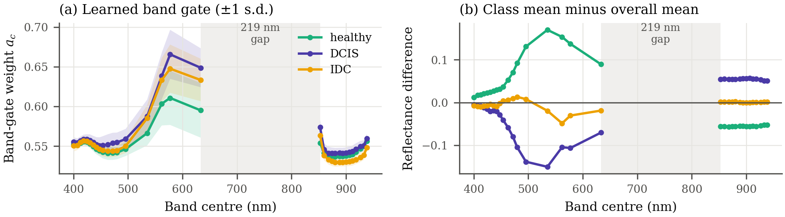

*Fig. 10. (a) Band-gate weights $a_c$ of (5), averaged within each patch, for 9,000 class-balanced test patches (seed 42), with ±1 s.d. bands. (b) Difference between each class's mean spectrum and the overall mean, for the same patches.*

Fig. 11 shows what the final answer state still knows about the input. The auxiliary decoder rebuilds the 32-band spectra of validation patches with a mean spectral angle of 6.2° at the selected epoch (9.5° after the first epoch, 5.3° at epoch 20). Typical reconstructions follow the input spectrum closely, including the absorption minimum near 535 nm, and keep the spatial pattern of the patch. The worst case, an IDC patch with an angle of 20.6°, is a saturated, nearly uniform patch without the usual stain absorption, which the decoder pulls toward a typical tissue spectrum. Because the answer state (11 × 11 × 128) is larger than the input (32 × 11 × 11), good reconstruction is not surprising. Its value is as evidence that the representation keeps the shape of the spectrum, and as an auxiliary objective that, by Table V, may help with DCIS.

<!-- tex: wide; width=0.74 -->
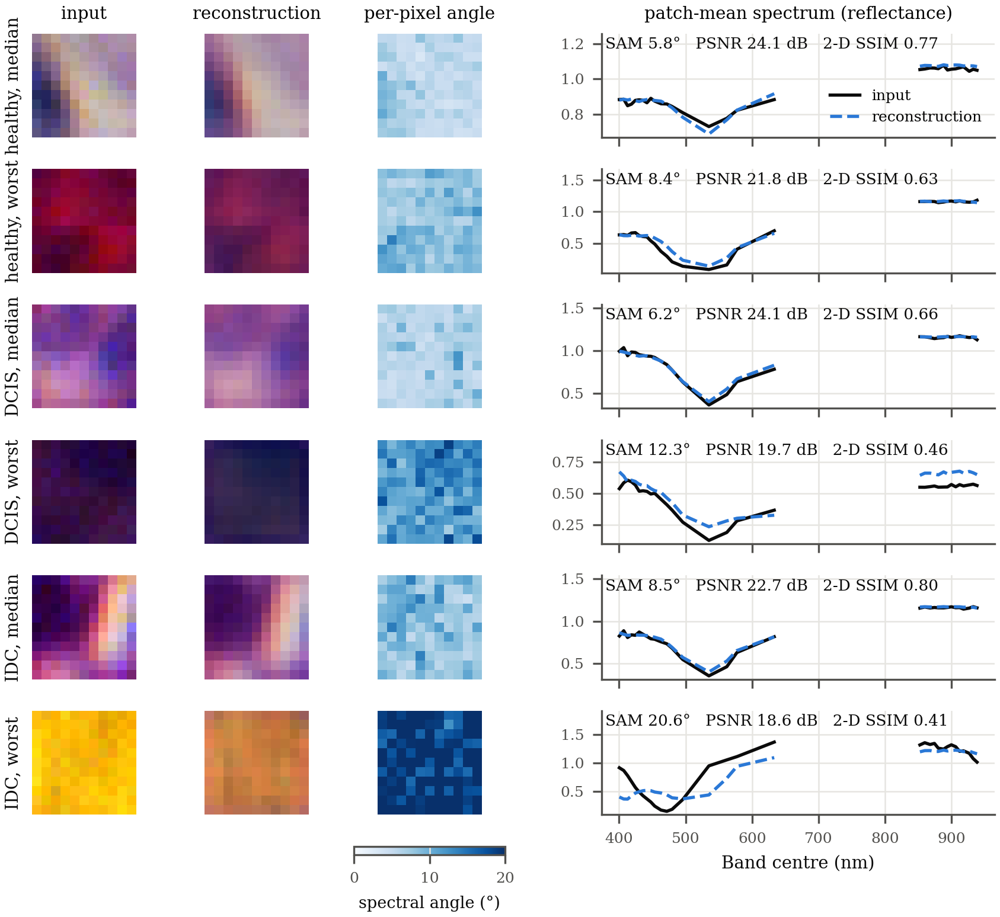

*Fig. 11. Spectral reconstruction of validation patches (seed 42): one median and one worst patch per class, ranked by spectral angle (11). Left: three-band composites of input and reconstruction on a common scale, and the per-pixel spectral angle. Right: patch-mean spectra; no line is drawn across the 219 nm gap.*

---

## VII. Discussion

### A. What We Learned

**A spectral front end takes the band count out of the architecture.** Building the front end only from operations that share their weights across bands was enough to make the parameter count independent of the band count (Section VI-B), and a model retrained on a quarter of the bands lost little. Transfer without retraining depends on one detail of the wavelength code: tying its scale to the band count breaks transfer, and fixing the scale restores it at half of the bands. A code whose scale does not depend on $C$, perhaps combined with training on random band subsets [30], is the natural next design to test.

**TRM's recursion carries over, but not all of TRM's promises.** A 0.45 M-parameter recursive core trains stably on noisy, imbalanced patch classification, where the hierarchical MedMamba-SS did not train under the same recipe (Section VI-D). Three expectations one might take from TRM do not hold on our task: the halting signal does not learn, depth beyond 21 core applications buys nothing measurable, and reusing weights saves storage but not computation (Section VI-C). At 22.3× the arithmetic of the hierarchy, the parameter count of a recursive model says little about its cost. Whether recursion itself helps, compared with a non-recursive core of the same size, we have not tested.

**Patients matter more than seeds.** The largest effects in this study are not architectural. The gap between the two held-out patient sets is larger than any difference between seeds or between variants, and the errors that create it come from three patients (Section VI-E). With DCIS present in only one patient per held-out set, ten held-out patients are too few to pin down how well the model generalizes.

### B. Limitations

- **Band selection.** Labels of 16 captures from held-out patients entered the selection of the 32 input bands (Section III). A training-only selection exists, but no model has been retrained on it.
- **Held-out patients.** All results rest on ten non-training patients with one DCIS patient per set. The validation patients also choose each checkpoint, and test scores of development runs were recorded while the recipe was developed.
- **Labels and scope.** Labels are per capture, without pixel masks, and evaluation is per patch rather than per patient, the unit at which a diagnosis is made. DCIS is also the diagnosis on which pathologists agree least often [31]. The data come from one institution and one camera, and nothing here amounts to clinical validation.
- **Statistics.** The component studies are single runs whose effects lie within the spread between seeds, and no equal-size non-recursive control was trained.
- **Hierarchy.** MedMamba-SS does not train on these patches under our recipe, so its additions to MedMamba's stages remain unevaluated on hyperspectral data.
- **Scope of claims.** This paper evaluates our models only. It does not compare them with other hyperspectral or channel-adaptive classifiers [30], [32], [33], [34], and it makes no claim of advantage over them.

### C. Future Work

The limitations point to four experiments whose inputs are already prepared: retraining on the training-only band selection; patient-level five-fold cross-validation with band selection repeated inside each fold, which tests every one of the 45 patients, including all seven with DCIS; a second hyperspectral histology dataset from a different camera, HMI-LUSC (lung squamous cell carcinoma, 10 patients, 61 bands from 450 to 750 nm) [35]; and multi-seed component studies that include an equal-size non-recursive control. Beyond these, a band-count-independent wavelength code and a fused SS2D kernel, which would give the recursive core a spatial state-space mixer again, are the next design steps.

---

## VIII. Conclusion

We set out to build a hyperspectral tissue classifier that does not depend on how many bands a camera records and that stays small enough for a small cohort. Following MedMamba [5] and the Tiny Recursive Model [7], we built it in two steps: a spectral–spatial front end, which gives MedMamba-SS its name, and a recursive core, which gives MedMamba-SS-TRM its name. Two properties hold by design and were confirmed by measurement: the model has the same 446,409 parameters at every band count, and its recursion trades 6.2× fewer parameters for 22.3× more arithmetic. Trained on breast histology from 45 patients, the model reaches 92.8 % balanced accuracy on the test patients, keeps most of its accuracy when retrained on a quarter of the bands, and transfers to half of its bands without retraining once its wavelength code is held fixed. Its weaknesses are as instructive as its strengths: accuracy on the validation patients is much lower, the errors concentrate in three patients, and depth beyond 21 core applications adds nothing. Settling how well such a model generalizes now needs more patients, band selection restricted to training data, and a second camera.

---

## Acknowledgment

The hyperspectral histology data are from the HistologyHSI-BC-Recurrence collection [11], described in [12] and accessed through The Cancer Imaging Archive under the CC BY 4.0 license and the TCIA Data Usage Policy. The author thanks the creators of the collection for making it public, and the authors of MedMamba and of the Tiny Recursive Model for releasing their code [8], [9]. Code and trained checkpoints will be released on acceptance.

A generative AI assistant (Claude, Anthropic) was used to help draft and revise the text of this manuscript and to help write and debug code for the experiments, analyses and figures. The author directed this work, checked the text, numbers and references against the experimental records, and takes full responsibility for the content.

---

## References

[1] G. Lu and B. Fei, "Medical hyperspectral imaging: A review," *J. Biomed. Opt.*, vol. 19, no. 1, Art. no. 010901, Jan. 2014, doi: 10.1117/1.JBO.19.1.010901.

[2] S. Fatima, A. A. Salam, M. U. Akram, I. A. Hameed, and S. B. Ahmed, "Incremental learning approach for semantic segmentation of skin histology images," *Sci. Rep.*, vol. 16, Art. no. 9593, 2026, doi: 10.1038/s41598-025-31553-6.

[3] A. Pandey and S. B. Ahmed, "Hyperspectral melanoma segmentation using SLIC-derived pseudo-labels," in *Proc. Comput. Vis. Conf. (CVC) 2026, Vol. 3*, ser. Lecture Notes in Networks and Systems. Springer, 2026, pp. 171–183, doi: 10.1007/978-3-032-26217-2_14.

[4] S. Fatima, M. U. Akram, S. Mohammad, and S. B. Ahmed, "Deep learning in dermatopathology: Applications for skin disease diagnosis and classification," *Discover Appl. Sci.*, vol. 7, Art. no. 1006, 2025, doi: 10.1007/s42452-025-07138-3.

[5] Y. Yue and Z. Li, "MedMamba: Vision Mamba for medical image classification," arXiv:2403.03849, 2024. [Online]. Available: https://arxiv.org/pdf/2403.03849

[6] A. Gu and T. Dao, "Mamba: Linear-time sequence modeling with selective state spaces," in *Proc. Conf. Lang. Model. (COLM)*, 2024. [Online]. Available: https://openreview.net/forum?id=tEYskw1VY2

[7] A. Jolicoeur-Martineau, "Less is more: Recursive reasoning with tiny networks," arXiv:2510.04871, Oct. 2025. [Online]. Available: https://arxiv.org/pdf/2510.04871

[8] Y. Yue and Z. Li, "MedMamba," GitHub repository, 2024. [Online]. Available: https://github.com/YubiaoYue/MedMamba

[9] A. Jolicoeur-Martineau, "TinyRecursiveModels," GitHub repository, 2025. [Online]. Available: https://github.com/SamsungSAILMontreal/TinyRecursiveModels

[10] Y. Liu et al., "VMamba: Visual state space model," in *Proc. Adv. Neural Inf. Process. Syst. (NeurIPS)*, vol. 37, 2024, pp. 103031–103063. [Online]. Available: https://proceedings.neurips.cc/paper_files/paper/2024/hash/baa2da9ae4bfed26520bb61d259a3653-Abstract-Conference.html

[11] L. Quintana Quintana et al., "Recurrent breast cancer: Histopathological and hyperspectral images database (HistologyHSI-BC-Recurrence)," Version 1 [Data set], The Cancer Imaging Archive, 2025. [Online]. Available: https://doi.org/10.7937/6KPY-YT49

[12] L. Quintana-Quintana et al., "Histological hyperspectral breast cancer recurrence database (HistologyHSI-BC Recurrence)," *Sci. Data*, vol. 12, Art. no. 1886, 2025, doi: 10.1038/s41597-025-06157-4.

[13] F. Pedregosa et al., "Scikit-learn: Machine learning in Python," *J. Mach. Learn. Res.*, vol. 12, pp. 2825–2830, 2011. [Online]. Available: https://jmlr.org/papers/v12/pedregosa11a.html

[14] A. Vaswani, N. Shazeer, N. Parmar, J. Uszkoreit, L. Jones, A. N. Gomez, Ł. Kaiser, and I. Polosukhin, "Attention is all you need," in *Proc. Adv. Neural Inf. Process. Syst. (NeurIPS)*, vol. 30, 2017, pp. 5998–6008. [Online]. Available: https://proceedings.neurips.cc/paper/2017/hash/3f5ee243547dee91fbd053c1c4a845aa-Abstract.html

[15] M. S. Khan, E. Atoofian, and S. B. Ahmed, "Quantum enchanced [sic] multi-scale CNN with bi-directional Mamba for crop field analysis," arXiv:2606.17222, 2026. [Online]. Available: https://arxiv.org/abs/2606.17222

[16] E. Perez, F. Strub, H. de Vries, V. Dumoulin, and A. Courville, "FiLM: Visual reasoning with a general conditioning layer," in *Proc. AAAI Conf. Artif. Intell.*, vol. 32, no. 1, 2018, doi: 10.1609/aaai.v32i1.11671.

[17] H. Touvron, M. Cord, A. Sablayrolles, G. Synnaeve, and H. Jégou, "Going deeper with image transformers," in *Proc. IEEE/CVF Int. Conf. Comput. Vis. (ICCV)*, 2021, pp. 32–42, doi: 10.1109/ICCV48922.2021.00010.

[18] N. Shazeer, "GLU variants improve Transformer," arXiv:2002.05202, 2020. [Online]. Available: https://arxiv.org/abs/2002.05202

[19] B. Zhang and R. Sennrich, "Root mean square layer normalization," in *Proc. Adv. Neural Inf. Process. Syst. (NeurIPS)*, vol. 32, 2019. [Online]. Available: https://proceedings.neurips.cc/paper_files/paper/2019/hash/1e8a19426224ca89e83cef47f1e7f53b-Abstract.html

[20] T.-Y. Lin, P. Goyal, R. Girshick, K. He, and P. Dollár, "Focal loss for dense object detection," in *Proc. IEEE Int. Conf. Comput. Vis. (ICCV)*, 2017, pp. 2999–3007, doi: 10.1109/ICCV.2017.324.

[21] M. P. Naeini, G. Cooper, and M. Hauskrecht, "Obtaining well calibrated probabilities using Bayesian binning," in *Proc. AAAI Conf. Artif. Intell.*, vol. 29, no. 1, 2015, pp. 2901–2907, doi: 10.1609/aaai.v29i1.9602.

[22] C. Guo, G. Pleiss, Y. Sun, and K. Q. Weinberger, "On calibration of modern neural networks," in *Proc. Int. Conf. Mach. Learn. (ICML)*, ser. Proc. Mach. Learn. Res., vol. 70, 2017, pp. 1321–1330. [Online]. Available: https://proceedings.mlr.press/v70/guo17a.html

[23] G. W. Brier, "Verification of forecasts expressed in terms of probability," *Mon. Weather Rev.*, vol. 78, no. 1, pp. 1–3, 1950, doi: 10.1175/1520-0493(1950)078<0001:VOFEIT>2.0.CO;2.

[24] A. Paszke et al., "PyTorch: An imperative style, high-performance deep learning library," in *Proc. Adv. Neural Inf. Process. Syst. (NeurIPS)*, vol. 32, 2019, pp. 8024–8035. [Online]. Available: https://proceedings.neurips.cc/paper_files/paper/2019/hash/bdbca288fee7f92f2bfa9f7012727740-Abstract.html

[25] I. Loshchilov and F. Hutter, "Decoupled weight decay regularization," in *Proc. Int. Conf. Learn. Represent. (ICLR)*, 2019. [Online]. Available: https://openreview.net/forum?id=Bkg6RiCqY7

[26] T. Chen, B. Xu, C. Zhang, and C. Guestrin, "Training deep nets with sublinear memory cost," arXiv:1604.06174, 2016. [Online]. Available: https://arxiv.org/abs/1604.06174

[27] Y. Geifman, G. Uziel, and R. El-Yaniv, "Bias-reduced uncertainty estimation for deep neural classifiers," in *Proc. Int. Conf. Learn. Represent. (ICLR)*, 2019. [Online]. Available: https://openreview.net/forum?id=SJfb5jCqKm

[28] Y. Geifman and R. El-Yaniv, "Selective classification for deep neural networks," in *Proc. Adv. Neural Inf. Process. Syst. (NeurIPS)*, vol. 30, 2017, pp. 4878–4887. [Online]. Available: https://proceedings.neurips.cc/paper/2017/hash/4a8423d5e91fda00bb7e46540e2b0cf1-Abstract.html

[29] M. M. Sibhai, A. Alkhateeb, and S. B. Ahmed, "MedFormer-UR: Uncertainty-routed transformer for medical image classification," arXiv:2604.08868, 2026. [Online]. Available: https://arxiv.org/abs/2604.08868

[30] Y. Bao, S. Sivanandan, and T. Karaletsos, "Channel vision transformers: An image is worth 1 × 16 × 16 words," in *Proc. Int. Conf. Learn. Represent. (ICLR)*, 2024. [Online]. Available: https://openreview.net/forum?id=CK5Hfb5hBG

[31] J. G. Elmore et al., "Diagnostic concordance among pathologists interpreting breast biopsy specimens," *JAMA*, vol. 313, no. 11, pp. 1122–1132, 2015, doi: 10.1001/jama.2015.1405.

[32] Z. Xiong et al., "Neural plasticity-inspired multimodal foundation model for Earth observation," arXiv:2403.15356, 2024. [Online]. Available: https://arxiv.org/abs/2403.15356

[33] N. J. Shahi and S. B. Ahmed, "Band-aware transformer (BAT-Former) for general image understanding," in *Proc. Comput. Vis. Conf. (CVC) 2026, Vol. 3*, ser. Lecture Notes in Networks and Systems. Springer, 2026, pp. 184–200, doi: 10.1007/978-3-032-26217-2_15.

[34] A. Baumann, L. Ayala, S. Seidlitz, J. Sellner, A. Studier-Fischer, B. Özdemir, L. Maier-Hein, and S. Ilic, "CARL: Camera-agnostic representation learning for spectral image analysis," arXiv:2504.19223, 2025. [Online]. Available: https://arxiv.org/abs/2504.19223

[35] Z. Yan, H. Huang, Y. Guo, J. Shi, R. Geng, J. Zhang, Y. Chen, and Y. Nie, "HMI-LUSC: A histological hyperspectral imaging dataset for lung squamous cell carcinoma," *Sci. Data*, vol. 13, Art. no. 415, 2026, doi: 10.1038/s41597-026-06766-7.
