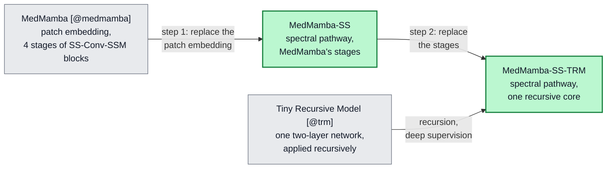

# MedMamba-SS-TRM: A Tiny Recursive Classifier for Hyperspectral Breast Histology That Works with Any Number of Bands

**Gabriel M. Del Valle Lopez**
Department of Computer Science

---

***Abstract*—A hyperspectral camera records, for every pixel, how much light the tissue reflects in many narrow wavelength bands, and these spectra can separate tissue types that look alike to the eye. Two practical problems make such data hard to use: cameras differ in how many bands they record, while most neural networks are built for one fixed number, and medical datasets are small, which favours small models. We address both by extending two published architectures, and the model's name records each step. MedMamba-SS adds a spectral–spatial (SS) front end to MedMamba, a state-space classifier for medical images: it reads each pixel's bands as an ordered sequence labelled by wavelength and then averages over them, so no weight depends on the number of bands. MedMamba-SS-TRM then replaces MedMamba's stack of stages with one small network applied 63 times, following the Tiny Recursive Model (TRM). On hyperspectral images of healthy breast tissue, ductal carcinoma *in situ* and invasive ductal carcinoma from 45 patients, MedMamba-SS-TRM has the same 446,409 parameters at 32, 16 and 8 bands. Over five training seeds it reaches 92.8 ± 1.9 % balanced accuracy on the five test patients but 76.2 ± 4.6 % on the five validation patients, and most errors come from three patients. Retrained on 8 bands, it keeps 96 % of its balanced accuracy, and a trained checkpoint transfers to 16 bands without retraining (90.9 %). Reusing one network makes the model 6.2× smaller than its hierarchical predecessor but costs 22.3× more arithmetic, and more than 21 applications add nothing measurable. Because the 32 input bands were selected with labels that included held-out patients, these results are provisional.**

***Index Terms*—Hyperspectral imaging, breast histopathology, state-space models, MedMamba, recursive networks, weight sharing, band-count agnosticism.**

---

## I. Introduction

When a pathologist examines a stained breast biopsy, one of the first questions is whether the tissue is healthy, ductal carcinoma *in situ* (DCIS), a cancer still confined to the milk ducts, or invasive ductal carcinoma (IDC), which has grown into the surrounding tissue. The answer is read from the shape and arrangement of cells. Hyperspectral imaging (HSI) adds a second kind of evidence. A hyperspectral camera measures, at every pixel, how much light the tissue reflects in each of tens to hundreds of narrow wavelength bands, so each pixel carries a spectrum rather than a single colour. Because stained tissue absorbs light according to its chemical make-up, these spectra can separate tissue types that look alike to the eye [@hsi_review].

Turning such images into a reliable classifier runs into two practical problems. The first is the sensor. Hyperspectral cameras differ in how many bands they record and at which wavelengths, yet the first layer of most image classifiers holds a separate set of weights for every input channel. A model trained for one camera therefore cannot even accept data from another, and it treats the bands as an unordered set, although their order by wavelength is physically meaningful. Histology models are known to degrade even when only the magnification changes [@skin_incremental]; a change of camera, and with it of the band set, is a larger shift. The second problem is data. Hyperspectral medical datasets come from few patients and detailed annotations are scarce [@hsi_review], [@hsi_melanoma], and a recent review of deep learning in dermatopathology lists scarce annotations, computational cost and poor generalization across acquisition conditions among the field's main open problems [@derm_review]. Small datasets favour small models.

We address both problems by building on two published architectures rather than designing a new one. The first is MedMamba [@medmamba], an image classifier for medical data built from state-space models. A state-space model, of which Mamba [@mamba] is the best-known recent example, reads a sequence one element at a time while carrying a compact memory, and learns at each step what to keep and what to forget; its cost grows only linearly with the length of the sequence. MedMamba combines such scans with convolutions and has been evaluated across many medical imaging modalities, which makes it a natural starting point. As published, however, its first layer is tied to the number of input channels and blind to their wavelengths. The second is the Tiny Recursive Model (TRM) [@trm], which showed that one small two-layer network, applied over and over to refine its own answer, can solve reasoning puzzles better than networks with several times its parameters. The lesson we take from TRM is that depth can come from repetition instead of from stored weights, which is attractive when data are scarce.

Our model follows both base architectures and changes only what hyperspectral histology requires, in two steps whose names record the lineage. **MedMamba-SS**, where SS stands for *spectral–spatial*, keeps MedMamba's spatial processing and replaces its first layer with a spectral pathway: a small module that reads each pixel's bands as an ordered sequence, labels every band with its wavelength, and then averages over the bands, so that none of its weights depends on how many bands there are. **MedMamba-SS-TRM**, where TRM stands for *Tiny Recursive Model*, keeps that spectral pathway and replaces the stack of processing stages of MedMamba-SS with TRM's single network applied recursively. The result has 446,409 parameters whatever the number of input bands.

Our contributions are:

- MedMamba-SS, a spectral–spatial extension of MedMamba whose parameters do not depend on the number of bands;
- MedMamba-SS-TRM, a recursive version that follows TRM, with 6.2× fewer parameters than MedMamba-SS and an explicit account of the extra arithmetic that recursion costs;
- an evaluation on hyperspectral breast histology from 45 patients, over five seeds and patient by patient, that shows where the model works and where it fails.

The paper follows the model from its origins to its behaviour. Section II summarizes the two base architectures, Section III introduces the data, and Section IV builds MedMamba-SS and MedMamba-SS-TRM step by step. Section V describes how the models were trained and measured, Section VI asks what the trained model can and cannot do, Section VII discusses what we learned and the limits of the evidence, and Section VIII concludes.

---

## II. The Two Models We Build On

Both base models are described in full in their original papers [@medmamba], [@trm] and code [@medmamba_code], [@trm_code]; we summarize only what the rest of this paper needs. Fig. {{F:lineage}} shows how the two combine into our models.

<!-- tex: mermaid=fig_lineage; wide; width=0.82 -->

*Fig. {{F:lineage}}. Where our models come from. Each arrow from a grey base model is one substitution; green boxes are the models of this paper (Section IV).*

### A. Hyperspectral Patches

We work with small hyperspectral patches $X \in \mathbb{R}^{C \times H \times W}$: images of $H \times W$ pixels with $C$ bands, where band $c$ is centred at wavelength $\lambda_c$. Reading along the band axis at one pixel gives that pixel's spectrum, a vector of $C$ values ordered by wavelength. Neighbouring bands are strongly correlated, and the shape of the spectrum, more than any single value, carries the information.

### B. MedMamba

MedMamba [@medmamba] processes an image in three parts. A *patch embedding*, a strided convolution, turns the input into a grid of feature vectors. Four *stages* of SS-Conv-SSM blocks then process the grid. Each block splits its channels in two: one half goes through convolutions that capture local texture, the other through a two-dimensional selective scan (SS2D) [@vmamba] that sweeps the grid in four directions and captures long-range context, and the two halves are then mixed again. Between stages, *patch merging* halves the grid and doubles the number of channels, so deeper stages see the image at coarser scales. A classifier reads the last stage.

One component of this design does not fit hyperspectral data. The patch embedding has a separate weight for every input channel: with patch size $p$ and $D_0$ output channels it holds

$$p^2 C D_0 + 3 D_0 \tag{1}$$

parameters, including its normalization, so its size grows with the band count $C$. A model built for 32 bands cannot accept 16, and because the convolution sums over channels as an unordered set, it never uses the fact that bands are ordered by wavelength.

### C. The Tiny Recursive Model

TRM [@trm] replaces a deep stack of different layers with one small network $f$ of two layers that is used many times. Besides the embedded input $x$, it keeps two states: an *answer* state $y$, its current guess, and a *latent* state $z$, a scratchpad. One *improvement step* first refines the scratchpad $n$ times and then updates the answer:

$$z \leftarrow f(x + y + z) \;\; (n \text{ times}), \qquad y \leftarrow f(y + z). \tag{2}$$

A recursion runs $T$ improvement steps; to save memory, the first $T-1$ run without tracking gradients, so they refine the states but are not trained through. Training uses *deep supervision*: the recursion is repeated over several supervision segments, each segment's answer is scored by the loss, and the states are carried into the next segment. In plain terms, the network drafts an answer and keeps revising it, and every revision is graded. TRM also learns a halting signal that decides when to stop, and it evaluates an exponential moving average (EMA) of its weights, a smoothed copy that changes slowly during training. It was evaluated on small puzzles with exact answers, and it reports parameters and accuracy but not arithmetic cost.

---

## III. Data

All experiments use the HistologyHSI-BC-Recurrence collection [@hsibc_data], [@hsibc_paper]: hyperspectral images, taken at 10× magnification, of breast biopsy slides stained with haematoxylin and eosin (H&E). The release we use holds 644 captures from 45 patients. Each capture has 740 bands, most are 600 × 1,004 pixels, and each carries one tissue label: healthy, DCIS or IDC. We start from the collection's calibrated images and multiply each capture by a gain that brings its median intensity to the median over all captures (clipped to [0.5, 2]); all values are then divided by one global constant. Neither step uses labels, but both are computed over captures from all patients.

**Patients and patches.** The 45 patients are split into 35 for training, 5 for validation and 5 for testing, at random within groups defined by each patient's rarest tissue class, so that no patient appears in more than one set. Only seven patients have DCIS: five are in training, one (patient 197) in validation and one (patient 136) in test. Every capture is cut into non-overlapping 11 × 11 patches, and every patch inherits its capture's label; no pixel-level mask is applied, so a patch from a capture labelled IDC may contain stroma or background. Table {{T:data}} gives the counts. Two facts from it shape the rest of the paper: IDC outnumbers DCIS 13 to 1 in training, and each held-out set has DCIS from a single patient.

<!-- tex: wide; cols=lrrrr -->
**TABLE {{T:data}}**
**Patients / Captures / Patches per Class and Split**

| Split | Healthy | DCIS | IDC | All |
| --- | ---: | ---: | ---: | ---: |
| Training | 30 / 147 / 722,358 | 5 / 25 / 122,850 | 34 / 327 / 1,606,878 | 35 / 499 / 2,452,086 |
| Validation | 4 / 20 / 98,280 | 1 / 5 / 24,570 | 5 / 49 / 211,666 | 5 / 74 / 334,516 |
| Test | 4 / 17 / 83,538 | 1 / 5 / 24,570 | 5 / 49 / 240,786 | 5 / 71 / 348,894 |

*A patient is counted under every tissue type it has. A full-size capture gives 4,914 patches.*

**Band selection.** Using all 740 bands would make every patch large and highly redundant, so one preparation step keeps 32. Each band is scored by the average of its variance and its mutual information with the tissue label [@sklearn], that is, how much knowing the band's value tells about the label, and bands are taken in order of decreasing score, skipping any band within eight bands of, or correlated above 0.95 with, a band already taken. The 32 bands span 400.5–938.2 nm unevenly: 18 lie at or below 633.3 nm and 14 between 852.3 and 938.2 nm, with a 219 nm gap between them where the scores are lowest. Fig. {{F:data}}(a) shows the class-mean spectra over these bands, and Fig. {{F:data}}(b) one patch of each class.

<!-- tex: width=1.0 -->

*Fig. {{F:data}}. (a) Class-mean spectra of 30,000 training patches over the 32 selected bands; no line is drawn across the 219 nm gap. (b) One test patch per class, shown as a false-colour composite of three bands.*

One caveat matters for everything that follows. The band scores were computed on 64 captures drawn before the patient split, 16 of them from validation and test patients, so labels of held-out patients influenced which bands the model sees. Repeating the selection on training patients alone moves every band by at most 5.1 nm (median 1.5 nm) and keeps the same layout, but no model has yet been retrained on that version, so the results below are provisional on this point.

---
