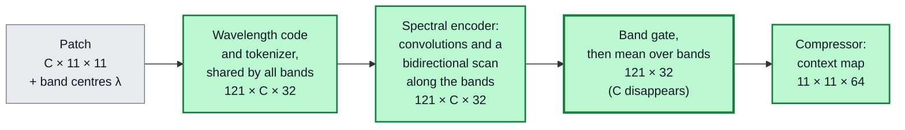
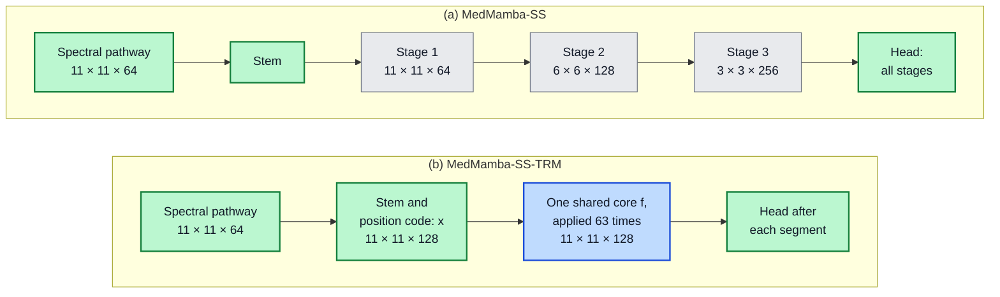
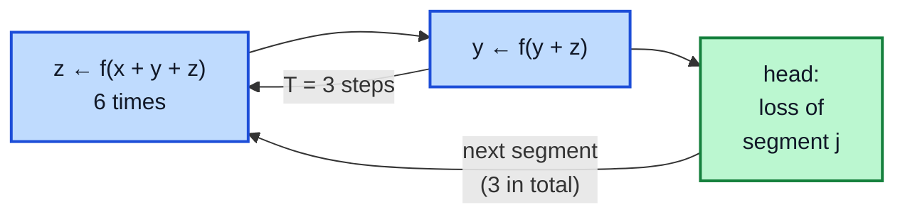

## IV. From MedMamba to MedMamba-SS-TRM

We build the model in two steps, and each step replaces exactly one component of the model it starts from (Fig. {{F:lineage}}). The first step gives MedMamba a front end that reads spectra and does not depend on the band count (Section IV-A), which yields MedMamba-SS (Section IV-B). The second replaces the stages of MedMamba-SS with TRM's recursion (Section IV-C), which yields MedMamba-SS-TRM; Section IV-D states what that recursion costs.

### A. Step 1: The Spectral Pathway

The spectral pathway replaces MedMamba's patch embedding. Its job is to turn each pixel's spectrum, whatever its length, into a vector of fixed size. The idea is borrowed from language models: we treat a spectrum like a sentence in which each band is a word, and the band's wavelength plays the role of the word's position. Every operation either shares its weights across all bands or has no weights at all, so the same weights serve any number of bands. Fig. {{F:pathway}} shows the four operations and the tensor shapes for one patch.

<!-- tex: mermaid=fig_pathway; wide; width=0.95 -->

*Fig. {{F:pathway}}. The spectral pathway, with tensor shapes for one 11 × 11 patch with $C$ bands (121 pixels, tokens of width 32). Every step applies the same weights to every band; the band axis disappears at the mean over bands, so nothing after it depends on $C$.*

**Wavelength code.** Band centres are rescaled to the unit interval over the bands present, and a sinusoidal code, like the position code of a Transformer [@transformer], is computed from the result:

$$\begin{aligned} \tilde{\lambda}_c &= \frac{\lambda_c - \lambda_{\min}}{\lambda_{\max} - \lambda_{\min}}, \\ \pi_c[2i] &= \sin(\eta\, \tilde{\lambda}_c\, \omega_i), \quad \pi_c[2i+1] = \cos(\eta\, \tilde{\lambda}_c\, \omega_i), \end{aligned} \tag{3}$$

with frequencies $\omega_i = 10000^{-2i/d_t}$ and scale $\eta = C$. Unlike a code based on the band index, this one registers the 219 nm gap of Section III as a large step. Because the rescaling and $\eta$ both depend on the bands present, a given wavelength receives a different code when bands are removed; Section VI-B shows why this matters.

**Tokenizer.** One small two-layer network, shared by all bands, turns each band value $v_c$ and its code into a token of width $d_t = 32$:

$$t_c = W_2\, \mathrm{GELU}\big(W_1 [v_c \,;\, \pi_c] + b_1\big) + b_2 + g\, \pi_c. \tag{4}$$

**Spectral encoder.** The sequence of $C$ tokens passes through small one-dimensional convolutions along the band axis, which compare each band with its neighbours, and through a bidirectional selective scan [@mamba], which reads the whole sequence from short to long wavelengths and back. This scan has the gated form of MedMamba's selective scan, applied to the one axis that MedMamba does not model; scanning spectra in both directions follows [@crop_mamba].

**Band gate and pooling.** A learned gate gives each band a weight between 0 and 1, and the weighted tokens are averaged over the bands and compressed by a small network $\Psi$ into a context vector of size 64 for each pixel:

$$a_c = \sigma\big(w_g^{\top} t_c + b_g\big), \qquad u = \Psi\Big(\frac{1}{C} \sum_{c=1}^{C} a_c\, t_c\Big) \in \mathbb{R}^{64}. \tag{5}$$

The average in (5) is where the band axis disappears. The gate also leaves a readable record of which wavelengths the pathway emphasizes, which Section VI-F examines.

> **Property 1.** *No weight of the spectral pathway has a shape that depends on $C$, and every layer after the average in (5) receives inputs without a band axis. A model built on the pathway therefore has the same number of parameters for every band count, as long as its later layers do not output one value per band.*

The reason is simple: the code (3) and the average in (5) have no weights, and the tokenizer, convolutions, scan and gate apply the same weights to every band. The one module that breaks the property is the optional reconstruction decoder of Section IV-C, which outputs one channel per band; we therefore exclude it from every parameter and cost count. In total the pathway holds 38,724 parameters (Section IV-C gives the full count).

### B. MedMamba-SS

MedMamba-SS places the spectral pathway in front of MedMamba's stages (Fig. {{F:models}}(a)). A linear layer, the *stem*, projects the context map into the first stage, so the convolutional patch embedding, and with it the dependence on $C$, is gone. To let the spectrum inform every scale and not only the input, each stage is conditioned on the context map through FiLM [@film], which scales and shifts a block's features according to the spectrum, and a small gated update feeds the spatial features back into the context map between stages. The blocks keep MedMamba's channel split, convolutional branch and selective scan, and gain LayerScale [@layerscale] and a gated feed-forward layer (GEGLU) [@glu]; the classifier reads every stage. For 11 × 11 patches MedMamba-SS uses three stages of widths 64, 128 and 256 and has 2,773,007 parameters. We also built a *full-channel* variant in which both branches of each block see all channels (3,513,451 parameters).

<!-- tex: mermaid=fig_models; wide; width=0.95 -->

*Fig. {{F:models}}. The two proposed models on one 11 × 11 patch, with tensor shapes. (a) MedMamba-SS keeps MedMamba's stage structure (grey; its blocks gain spectral conditioning), which shrinks the grid and widens the features. (b) MedMamba-SS-TRM replaces them with one core that follows TRM (blue) and keeps the full grid throughout. Green: components introduced in this work.*

### C. Step 2: Recursion

The second step replaces the stack of stages with TRM's recursion (Fig. {{F:models}}(b)). We follow TRM's design and change only what a two-dimensional classification task requires; Table {{T:lineage}} lists where every component comes from and what changed.

**Input and states.** The context map is projected to width $d = 128$, normalized, and given a fixed two-dimensional position code, which gives the input $x$ of shape 11 × 11 × 128. As in TRM, the answer state $y$ and the latent state $z$ have the same shape and start from fixed values.

**Core.** The shared network $f$ has two blocks. Each block mixes neighbouring pixels with a depthwise 3 × 3 convolution, which filters every channel separately, followed by a channel MLP, and then applies a GEGLU feed-forward layer [@glu]; each part ends with RMS normalization [@rmsnorm], as in TRM. TRM mixes tokens with attention or an MLP; we use a convolution because our state is an 11 × 11 grid rather than a sequence. MedMamba's SS2D scan is implemented as an alternative mixer, but without a fused scan kernel it was 39× slower in a timing benchmark on 11 × 11 patches, so it is not used. MedMamba-SS-TRM therefore keeps a selective state-space scan along the spectral axis, inside its spectral pathway, but processes space with convolutions; its name records the lineage through MedMamba-SS.

**Schedule.** The core is applied exactly as in (2), with $n = 6$ and $T = 3$ (Fig. {{F:schedule}}). We run $N_{\text{sup}} = 3$ supervision segments inside a single forward pass and read the answer state after each with a small classifier (normalization, average over pixels, linear layer). The core is therefore applied

$$K = N_{\text{sup}} \cdot T \cdot (n + 1) = 3 \cdot 3 \cdot 7 = 63 \tag{6}$$

times per patch, at inference as well as in training. Keeping all segments in one forward pass, with one optimizer step per batch, lets a standard training loop run unchanged. TRM's halting signal is implemented but disabled, because on our task it did not learn to predict when an answer was correct.

<!-- tex: mermaid=fig_schedule; wide; width=0.62 -->

*Fig. {{F:schedule}}. The recursion of MedMamba-SS-TRM, following TRM (blue); $x$ comes from the stem and $y$, $z$ start from fixed values. An improvement step is six latent updates and one answer update; the first two of the three steps run without gradient. Three segments give the 63 core applications of (6); each segment's answer is scored by the loss, and the last one is the prediction.*

**Objective.** Each segment's prediction is scored by a class-weighted focal loss [@focal], which down-weights patches the model already classifies confidently and so counteracts the class imbalance. For a patch of class $k$ with predicted probability $p_k$,

$$\mathcal{L}_{\text{FL}} = -\,w_k\,(1 - p_k)^{\gamma} \log p_k, \qquad \gamma = 1.5, \tag{7}$$

where the class weight $w_k$ is proportional to $N_k^{-0.75}$, $N_k$ being the number of training patches of class $k$. As an auxiliary task, a three-layer convolutional decoder reconstructs the input spectra $X$ from the final answer state, and the total loss is

$$\begin{aligned} \mathcal{L} = \frac{1}{N_{\text{sup}}} \sum_{j=1}^{N_{\text{sup}}} \mathcal{L}_{\text{FL}}(\ell_j) &+ \lambda\, \mathrm{MSE}(\hat{X}, X) \\ &+ \lambda\, \mathrm{SAM}(\hat{X}, X), \end{aligned} \tag{8}$$

where $\ell_j$ are the class scores of segment $j$, $\hat{X}$ is the reconstruction, SAM is the spectral angle (11), and $\lambda = 0.1$. The decoder is not needed at inference. Table {{T:params}} gives the resulting parameter count: the shared core holds 89 % of the parameters, and no entry depends on $C$ or on $K$.

<!-- tex: wide; x=p{3.3cm}p{3.9cm}X p{3.6cm} -->
**TABLE {{T:lineage}}**
**Where Each Component of MedMamba-SS-TRM Comes From**

| Component | Origin | In MedMamba-SS-TRM | Reason |
| --- | --- | --- | --- |
| Spectral pathway | New; replaces MedMamba's patch embedding [@medmamba] | Wavelength code, shared tokenizer, spectral encoder, band gate, mean over bands (3)–(5) | Remove $C$ from every weight shape; read band order |
| Bidirectional spectral scan | MedMamba's selective scan [@medmamba], [@mamba] | Applied along the bands, in both directions | Model the ordered spectrum |
| Stages of SS-Conv-SSM blocks | MedMamba [@medmamba], kept in MedMamba-SS | Replaced by one recursive core | Depth from reuse instead of stored weights |
| Core network $f$ | TRM [@trm]: two layers, attention or MLP mixer, width 512 | Two blocks, depthwise-convolution mixer, GEGLU, width 128 | The state is a 2-D grid; smaller model |
| Two states, improvement step, first $T-1$ steps without gradient | TRM [@trm] | As published (2), $n = 6$, $T = 3$ | — |
| Deep supervision | TRM [@trm]: up to 16 segments, one optimizer step each | 3 segments in one forward pass, losses averaged (8) | A standard training loop runs unchanged |
| Halting signal | TRM [@trm] | Implemented, disabled | Did not learn on this task |
| EMA of weights | TRM [@trm]: decay 0.999 | Decay 0.9995 | Retuned |
| Stem, head and loss | New | Linear stem with position code; classifier after every segment; focal loss and reconstruction (7)–(8) | Classify a 2-D map into three imbalanced classes |

<!-- tex: x=Xrr -->
**TABLE {{T:params}}**
**Parameters of MedMamba-SS-TRM (Decoder Excluded)**

| Component | Parameters | Share |
| --- | ---: | ---: |
| Spectral pathway (3)–(5): tokenizer 4,257; encoder 17,794; gate 33; compressor 16,640 | 38,724 | 8.7 % |
| Stem and position-code gain | 8,577 | 1.9 % |
| Shared core $f$, $L(12d^2 + 20d)$ with $L = 2$ blocks | 398,336 | 89.2 % |
| Classifier and (disabled) halting head | 772 | 0.2 % |
| **Total, at any band count** | **446,409** | |

*No entry depends on the band count $C$ or on the number of core applications $K$.*

### D. What Recursion Costs

Weight sharing separates two quantities that usually grow together: how many parameters a model stores and how much arithmetic, counted in floating-point operations (FLOPs), it performs. The core's parameters do not depend on how often it is applied, but every application costs the same arithmetic:

$$\mathcal{F}(K) = \mathcal{F}_0 + K\, \mathcal{F}_f, \qquad \mathcal{F}_f = 2\, N_{\text{tok}}\, L\, \big(12 d^2 + 9 d\big), \tag{9}$$

where $\mathcal{F}_0$ is everything outside the core, $N_{\text{tok}} = 121$ is the number of grid positions, $L = 2$ is the number of blocks, $12 d^2$ counts the multiply–accumulates per position of a block's two gated MLPs and $9d$ its depthwise convolution. For our configuration $\mathcal{F}_f = 95.72$ MFLOPs, so the 63 applications alone cost 6.03 GFLOPs per patch. A hierarchy is cheaper because it shrinks the grid at every stage (Fig. {{F:models}}(a)); the recursive core works on the full grid at every application. We measure arithmetic by counting the multiply–accumulates of every convolution and linear layer with forward hooks, plus an estimate for the selective scans; normalization, activations and the decoder are excluded.

---

## V. Experimental Setup

### A. How We Measure Performance

Because IDC patches outnumber DCIS patches 13 to 1, plain accuracy would reward a model that ignores DCIS. Our main metric is therefore *balanced accuracy*, the average over the three classes of the recall, the fraction of a class's patches classified correctly:

$$\mathrm{BA} = \frac{1}{3} \sum_{k} \frac{\mathrm{TP}_k}{\mathrm{TP}_k + \mathrm{FN}_k}. \tag{10}$$

A model that always predicts IDC scores 33.3 %. We also report *macro-F1*, the average over classes of the harmonic mean of precision and recall. Reconstruction is scored by the *spectral angle* between a reconstructed spectrum $\hat{x}$ and its target $x$,

$$\mathrm{SAM}(\hat{x}, x) = \arccos \frac{\langle \hat{x}, x \rangle}{\lVert \hat{x} \rVert\, \lVert x \rVert}, \tag{11}$$

which ignores overall brightness and compares only the shape of the spectrum. *Calibration*, whether a predicted confidence of 90 % is right 90 % of the time, is measured by the expected calibration error (ECE) over 15 confidence bins [@naeini], [@guo_calib] and by the Brier score [@brier].

### B. Training

All models were trained on one NVIDIA RTX 5060 Ti (16 GB) with PyTorch [@pytorch]. MedMamba-SS-TRM uses AdamW [@adamw] with learning rate $3 \times 10^{-4}$ and weight decay 0.05, batch size 256, bf16 precision, gradient clipping at 1.0, and a linear warm-up into a cosine decay; gradient checkpointing [@checkpoint] in the core is needed to fit training into 16 GB, and validation and testing use an EMA of the weights. Inputs are standardized per band with statistics from the training patients and augmented with flips, rotations, crops and small spectral noise, scaling and offsets. Each epoch trains on a fresh random 10.2 % of the training patches (250,113) and validates on a fixed patient-stratified 9.86 % of the validation patches (32,985); the checkpoint with the best validation macro-F1 is then scored on the full test set.

Main runs train for 20 epochs and are repeated with five seeds (1, 7, 13, 23 and 42). The component studies of Sections VI-B to VI-D train for 12 epochs at seed 42 and are compared with a 12-epoch run of the full model, because a shorter cosine schedule is a different schedule, not a truncated one. Two runs with the same seed differ by about 0.05 points of balanced accuracy, whereas the spread between seeds is about 2 points, so single-seed differences smaller than that spread are not conclusive. The training recipe was developed over earlier runs on the same patient split. Checkpoints were always chosen on validation data, but the test scores of those development runs were recorded, so the test patients are not demonstrably independent of recipe development.

---
